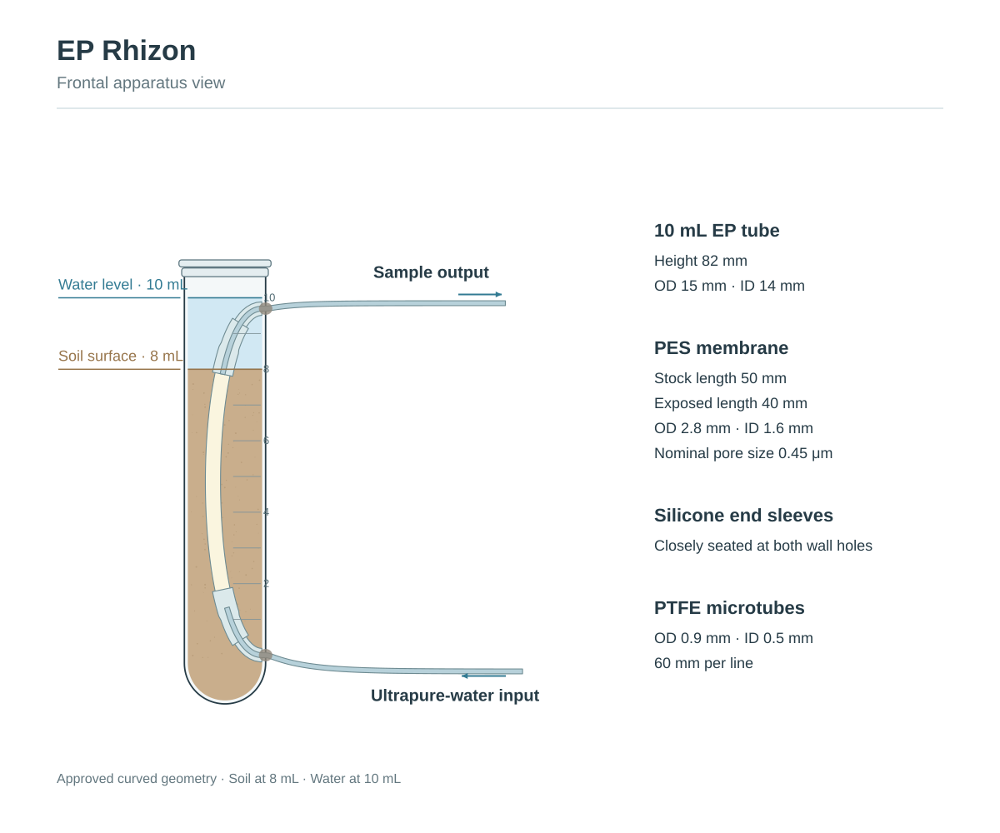

# EP Rhizon

**在线模型 / Live viewer:** [EP Rhizon · Three.js](https://leon-skyang.github.io/EP-Rhizon/)



Interactive Three.js visualization of a custom EP Rhizon porewater-equilibration device, with editable Blender and Adobe Illustrator source files.

以确认后的自然弯曲版为最终装置模型：**土面位于 8 mL 刻度，水面位于 10 mL 刻度**。上下硅胶接头贴近离心管壁开孔，两根外部 PTFE 管与内部弯曲结构平顺衔接。

## Contents

| File | Purpose |
| --- | --- |
| `index.html` | Built, self-contained Three.js viewer; serve this directory over HTTP |
| `EP-Rhizon.blend` | Final editable Blender source; opens the filled single-device scene |
| `EP-Rhizon.glb` | Single-device geometry exported from the final Blender source |
| `EP_Rhizon_01_Front.ai` / `.svg` | Editable frontal apparatus drawing |
| `EP_Rhizon_02_Equilibration.ai` / `.svg` | Apparatus with enlarged membrane transport schematic |
| `model-validation.json` | Saved-model fill heights and visibility verification |
| `main.js`, `styles.css`, `index.source.html` | Editable viewer source |

## Interaction

Drag to rotate, scroll to zoom, and right-drag to pan. Controls provide front/perspective views, reset, auto rotation, independent soil/water visibility, adjustable soil and tube-wall opacity, annotations, and Chinese/English labels. The membrane close-up illustrates diffusive solute exchange between the initially ultrapure lumen water and surrounding soil porewater.

## Dimensions

- EP tube: nominal 10 mL; height 82 mm; OD 15 mm; ID 14 mm.
- PES membrane: stock length 50 mm; exposed length 40 mm after sleeve overlaps; OD 2.8 mm; ID 1.6 mm; nominal pore size 0.45 μm.
- Silicone-a sleeve: nominal ID 2.5 mm, OD 3.5 mm, length 10 mm. Silicone-b sleeve: nominal ID 0.8 mm, OD 2.5 mm, length 10 mm; fitted bore accommodates PTFE OD 0.9 mm.
- PTFE: ID 0.5 mm; OD 0.9 mm; length 60 mm per line.
- Existing model graduations define the fill planes: 8 mL at local z = 61.8 mm; 10 mL at z = 75.0 mm. These are the approved model's graduation positions, not an independently calibrated volume measurement.

Blender uses millimetres. The GLB wraps the unchanged geometry in a 0.001 scale root so its coordinates use metres. The web viewer adjusts material appearance for readability; it does not redefine geometry.

## Source and scope

Device geometry follows the supplied photographs, Obsidian method dimensions, and the approved curved Blender model. The membrane detail follows the supplied sketch. The original photographs and Obsidian screenshot are retained locally and are not embedded in the distributed model. `Method.xlsx` was not used as the dimension authority.

The two-cup, six-device scene in the Blender file is a representative layout, not a statement of treatment assignment or actual replication. Cup diameter was selected illustratively; capacity 100 mL and height 90 mm were provided. The transport inset is schematic: pores, solute symbols, and their positions are not measured microstructure or concentration data. It depicts diminishing concentration gradients and bidirectional diffusion, without specifying an equilibration time or a particular chemical species.

## Local development

Requires Node.js 22.12+ or a compatible newer version.

```bash
npm ci
cp index.source.html index.html
npm run dev
```

To rebuild:

```bash
npm run build
```

The build produces `dist/`; the finished `dist/index.html` embeds its bundled JavaScript and CSS. Keep `public/` populated with the model and vector assets when rebuilding. For the flat published repository, copy the supplied model/vector files into `public/` before building, or use the included source archive, which already has the expected project layout.

Three.js and its controls/loaders are used under the MIT license; see `THIRD_PARTY_NOTICES.md`. No license for the author's device model or drawings is implied by the dependency license.
